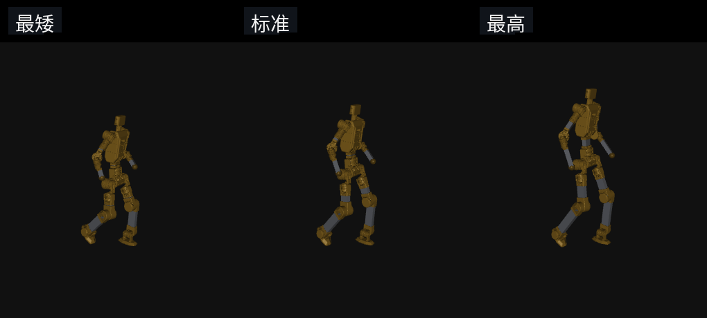

# Scaler Mimic Demo

MuJoCo 里看 Scaler 跟踪动作。策略是第 43100 次，固定 160 格得分 [34, 123, 39, 136]。

## 三种身高

同一段动作，从左到右是最矮、标准、最高。

**走路**


**跳舞**


**倒退**



## 运行

```bash
git clone git@github.com:wangshuyiHIT/scaler_mimic_demo.git
cd scaler_mimic_demo
bash demo.sh
```

第一次运行会安装 CPU 版 PyTorch 2.7.1 和 MuJoCo 3.8.1。

已有环境：

```bash
SCALER_MIMIC_PYTHON=/path/to/python bash demo.sh
```

左右方向键换动作。按住上、下改身高，松开即停。空格暂停，R 重来，L 循环，Esc 退出。

权重文件 `policy/snapshot_iteration43100.pt`，SHA-256 `57f026fdfffeaa7579d9fed8a3ebdd16df3b9f99215038dd02d248c972c09f68`。

## English

```bash
git clone git@github.com:wangshuyiHIT/scaler_mimic_demo.git
cd scaler_mimic_demo
bash demo.sh
```

Iteration 43100. Fixed 160-grid score [34, 123, 39, 136]. The clips are walking, dancing, and walking backward, each at short, nominal, and tall height. Left and right change the clip. Hold up or down to change height. Esc closes the window.
