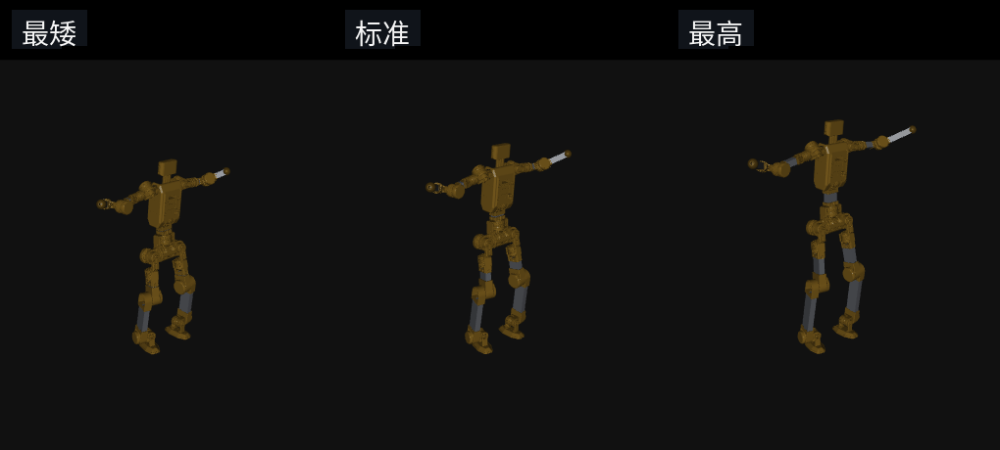
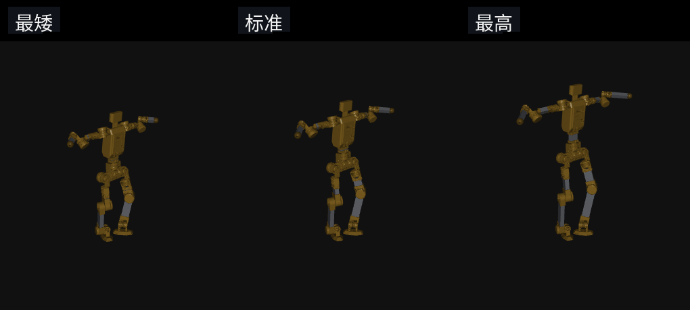
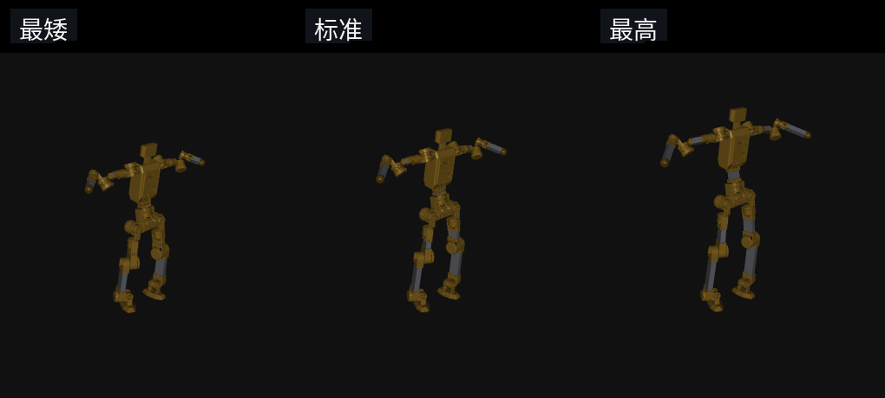

# Scaler Mimic Demo

窗口里放的是 43100 这次策略。固定 160 格 TRAIN 的分数是 [34, 123, 39, 136]，依次是完整且六门通过、任务通过、采样安全、完整完成。后来的同协议结果没有超过这组数。这是训练集上的一次分数。

## 三种身高

每张图都是同一段参考。左边最矮，中间标准，右边最高，摄像机没有动。杆长取的是播放允许范围的两端和零点。

片段从参考开始挪步之后接着录，大约 4 秒。前面几秒人还站着，那些帧没有放进来。

**走路** `walk1_subject1_000000_000300`



**跑步** `run1_subject2_000000_000300`



**舞蹈** `dance1_subject1_000000_000300`



## 打开

```bash
git clone git@github.com:wangshuyiHIT/scaler_mimic_demo.git
cd scaler_mimic_demo
bash demo.sh
```

第一次会自己建 `.venv`，装上 CPU 版 PyTorch 2.7.1 和 MuJoCo 3.8.1。

机器上已经有环境时：

```bash
SCALER_MIMIC_PYTHON=/path/to/python bash demo.sh
```

`bash scripts/sim2sim.sh --loop` 打开的是同一个窗口。

左右方向键换动作。按住上键、下键改身高，松开就停。空格暂停，R 从头播，L 开关循环，Esc 退出。

策略在 CPU 上算。改身高只改这一次播放里的杆长。

权重是 `policy/snapshot_iteration43100.pt`，SHA-256 `57f026fdfffeaa7579d9fed8a3ebdd16df3b9f99215038dd02d248c972c09f68`。

## English

```bash
git clone git@github.com:wangshuyiHIT/scaler_mimic_demo.git
cd scaler_mimic_demo
bash demo.sh
```

The window plays iteration 43100. On the fixed 160-grid TRAIN set the score is [34, 123, 39, 136]. Left and right change the clip. Hold up or down to change height. Esc closes the window.
